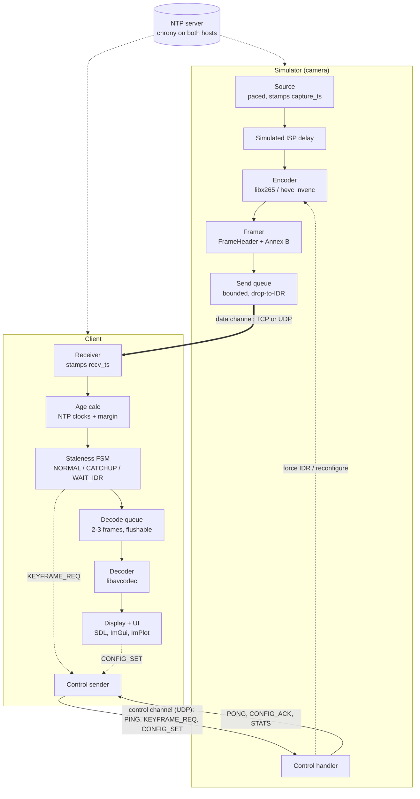
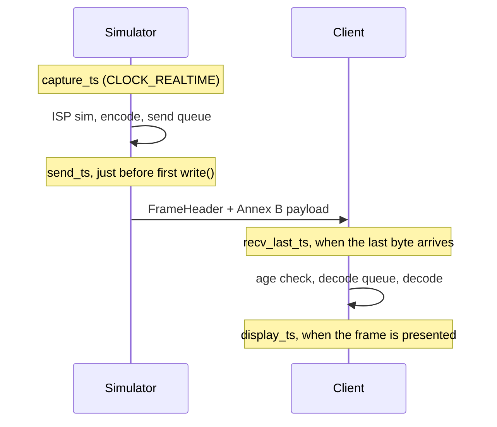
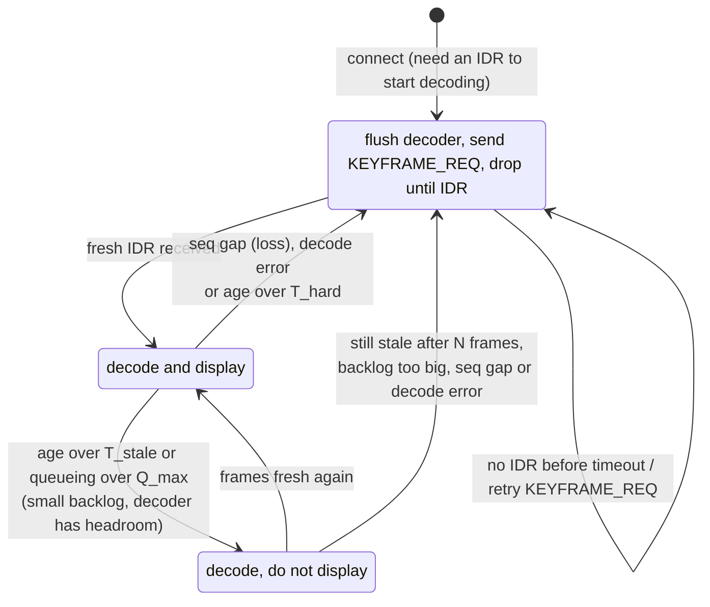
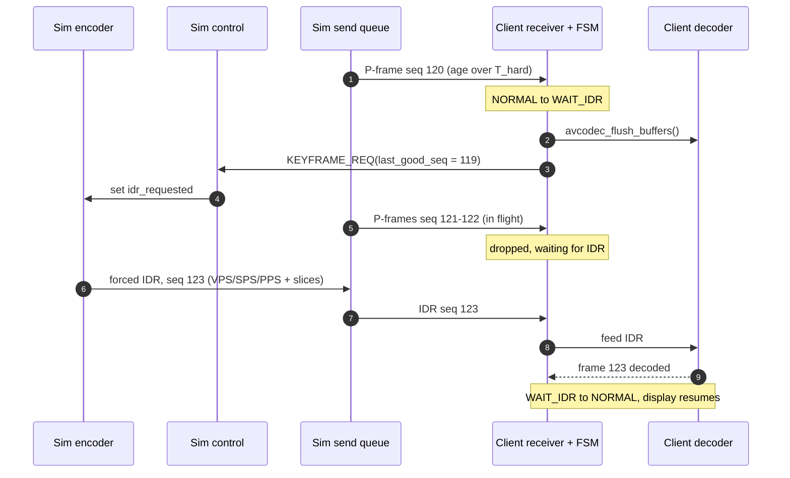

# H.265 camera simulator and low-latency client: architecture and plan

Status: draft sketch
Scope: a desktop simulator that behaves like a CV25-class camera serving inter-coded H.265, plus a demo client that receives it, tracks per-frame age, drops stale frames and recovers from lag. Both sides are built in C++ on FFmpeg's libraries.

---

## 1. Goals and non-goals

**Goals**

- End-to-end latency close to the floor set by encode and decode time, with no hidden buffering anywhere.
- An age for every frame (capture → display) that is visible and logged, and that drives drop and recovery decisions.
- Fast recovery when the client falls behind, using on-demand IDR plus flushing.
- Everything configurable: encoder, pacing, queues, transport, thresholds. Some of it adjustable live.
- Repeatable impairment testing with `tc netem`, and ground-truth validation of the age estimator.

**Non-goals (for now)**

- Standards-compliant RTSP/RTP or ONVIF interop.
- Audio, multiple streams per camera, recording.
- Bit-exact emulation of the Ambarella encoder. We model its *behaviour* (low-latency, IPPP, forced IDR), not its output.

---

## 2. System overview

Diagrams in this document are [Mermaid](https://mermaid.js.org/): plain text that renders on GitHub, GitLab and in VS Code, and that tools such as Claude Code can read and edit directly.



**Clock model.** Both machines are NTP-synchronised (chrony recommended). Timestamps that cross the network (`capture_ts`, `send_ts`, client `recv_ts`/`display_ts`) are `CLOCK_REALTIME` nanoseconds, so frame age is a direct subtraction. Durations measured within a single machine (encode time, queue wait, decode time, timers) use `CLOCK_MONOTONIC`, which never jumps. See §5.2 for how the sync error is handled.

---

## 3. Shared module (`common/`)

### 3.1 Wire format: data channel

One message per encoded access unit. Little-endian, packed, versioned.

```cpp
struct FrameHeader {            // 48 bytes
    uint32_t magic;             // 'HSIM'
    uint16_t version;           // 1
    uint16_t header_len;        // sizeof(FrameHeader), allows extension
    uint32_t seq;               // monotonically increasing, never reused
    uint32_t gop_id;            // increments on every IDR
    uint8_t  frame_type;        // 0 = P, 1 = IDR (from AV_PKT_FLAG_KEY)
    uint8_t  flags;             // bit0: forced IDR, bit1: after drop
    uint16_t reserved;
    uint64_t capture_ts_ns;     // CLOCK_REALTIME (NTP-disciplined)
    uint64_t send_ts_ns;        // CLOCK_REALTIME, stamped just before the first write()
    uint32_t payload_len;       // Annex B bytes that follow
    uint32_t reserved2;
};
// followed by payload_len bytes of Annex B H.265 (VPS/SPS/PPS repeated before each IDR)
```

For UDP (phase 2), each datagram also carries a fragment header: `seq, frag_idx, frag_count, total_len`. The payload is kept to 1200 bytes or less to avoid IP fragmentation.

### 3.2 Wire format: control channel (UDP, both directions)

| Type | Direction | Fields | Purpose |
|---|---|---|---|
| `PING` | C → S | `nonce, client_tx_ns` | RTT measurement |
| `PONG` | S → C | `nonce, client_tx_ns (echo), server_rx_ns, server_tx_ns` | RTT minus server handling |
| `KEYFRAME_REQ` | C → S | `reason, last_good_seq` | Ask for an immediate IDR |
| `CONFIG_SET` | C → S | `key, value` | Live tuning (bitrate, GOP, fps, injected delay …) |
| `CONFIG_ACK` | S → C | `key, value, applied_at_seq` | Confirms which frame the change took effect from |
| `STATS` | S → C | queue depth, drops, encoder timings | Shown in the client UI |

Control runs on a separate UDP socket. That way pings and keyframe requests never queue behind frame data. On a shared TCP stream, a PONG would sit behind megabytes of video.

### 3.3 Other shared pieces

- `Clock`: `wall_ns()` (`CLOCK_REALTIME`, for timestamps that cross the network) and `mono_ns()` (`CLOCK_MONOTONIC`, for local durations and timers). Also `sync_status()`, which reads `ntp_adjtime()` to report whether the clock is synchronised and its estimated/maximum error.
- `BoundedQueue<T>`: limits on frame count *and* bytes, with a pluggable overflow policy.
- `Config`: loaded with toml++ and overridden by CLI11 flags. The same struct is used for live `CONFIG_SET`.
- `NalUtil`: a minimal Annex B scanner. Used to assert that IDR frames really contain NAL types 19/20 plus VPS/SPS/PPS (32/33/34). Cheap insurance against misconfigured encoders.
- `FrameLog`: CSV writer, one row per frame per side, joined offline by `seq`.

---

## 4. Simulator (server)

### 4.1 Threads

| Thread | Responsibility |
|---|---|
| Source | Paced by an absolute-deadline timer (`clock_nanosleep(TIMER_ABSTIME)`). Produces a YUV420P frame and stamps `capture_ts`. |
| Encode | Waits out the optional simulated ISP delay, applies pending IDR requests and config changes, runs encode, and pushes packets to the framer. |
| Sender (Asio) | Pops from the send queue, stamps `send_ts`, writes to the socket, and applies the drop policy. |
| Control (Asio) | Handles PING, KEYFRAME_REQ and CONFIG_SET, and posts commands to the encode thread through a lock-free mailbox. |

The source and encode threads can be merged at first. They're kept separate so the simulated ISP delay and encoder latency stay independently measurable.

### 4.2 Frame source

Three interchangeable implementations behind `IFrameSource`:

1. **Synthetic**: moving pattern plus a burned-in **frame counter and capture-time clock** drawn into the Y plane (a simple 7-segment renderer, no dependencies). This lets the client verify every frame by eye.
2. **File playback**: `libavformat` + `libavcodec` decode → `libswscale` to target size/YUV420P → paced replay, looping on EOF (`av_seek_frame`). Use real footage from the rail cameras so bitrate and IDR sizes look realistic. Synthetic content compresses unrealistically well.
3. **V4L2 webcam** (optional): `libavdevice`, for live content.

### 4.3 Encoder (`libavcodec` + libx265)

```cpp
const AVCodec* codec = avcodec_find_encoder_by_name("libx265");   // or "hevc_nvenc"
AVCodecContext* enc = avcodec_alloc_context3(codec);
enc->width        = cfg.width;
enc->height       = cfg.height;
enc->pix_fmt      = AV_PIX_FMT_YUV420P;
enc->time_base    = {1, cfg.fps};
enc->framerate    = {cfg.fps, 1};
enc->gop_size     = cfg.gop;          // periodic IDR as a backstop, e.g. 1–2 s
enc->max_b_frames = 0;
enc->bit_rate     = cfg.bitrate;
enc->rc_max_rate  = cfg.bitrate;      // CBR-ish, like a camera
enc->rc_buffer_size = cfg.vbv_bits;   // small VBV = fewer size spikes, worse quality
// Do NOT set AV_CODEC_FLAG_GLOBAL_HEADER: we want in-band VPS/SPS/PPS.

av_opt_set    (enc->priv_data, "preset", cfg.preset.c_str(), 0);   // "ultrafast" to start
av_opt_set    (enc->priv_data, "tune",   "zerolatency", 0);
av_opt_set_int(enc->priv_data, "forced-idr", 1, 0);                // pict_type I => IDR, not CRA
av_opt_set    (enc->priv_data, "x265-params",
    "repeat-headers=1:frame-threads=1:bframes=0:rc-lookahead=0:scenecut=0:"
    "keyint=60:min-keyint=60", 0);
avcodec_open2(enc, codec, nullptr);
```

Per frame:

```cpp
frame->pts = seq;                                  // map packets back to capture_ts
if (idr_requested.exchange(false))
    frame->pict_type = AV_PICTURE_TYPE_I;          // forced IDR (with forced-idr=1)
else
    frame->pict_type = AV_PICTURE_TYPE_NONE;
avcodec_send_frame(enc, frame);
while (avcodec_receive_packet(enc, pkt) == 0) {
    // pkt->pts == seq; pkt->flags & AV_PKT_FLAG_KEY => IDR
    framer.emit(pkt, capture_ts_for(pkt->pts));
    av_packet_unref(pkt);
}
```

Notes:

- `zerolatency` with `frame-threads=1` gives one frame in, one packet out. Assert this in debug builds: if `receive_packet` returns `EAGAIN` after a `send_frame`, something is buffering.
- Parallelism comes from WPP (on by default in x265), which works *within* a frame and adds no latency. It also makes slice threading effective on the decoder.
- Changing bitrate live: libx265 can't be reconfigured through `libavcodec` mid-stream. The simple option is to reopen the encoder, which forces an IDR. That's acceptable for a simulator. Using the x265 API directly (`x265_encoder_reconfig`) is a later option.
- `hevc_nvenc` backend: same structure. It has its own `forced-idr`, `zerolatency`, `delay=0`, `rc=cbr` options. It's worth adding because its timing is closer to real silicon.

### 4.4 Send queue and drop policy

The queue is bounded by `max_frames` (e.g. 3) and `max_bytes`.

- **On enqueue overflow:** discard all queued frames, set `need_idr` (sent to the encoder as a forced IDR), then discard every new packet until an IDR arrives. Never send a P-frame whose reference was dropped.
- **On dequeue:** if `now − capture_ts > server_max_age`, apply the same drop-to-IDR path.
- Every drop is logged with a reason (`overflow`, `too_old`, `waiting_idr`).

### 4.5 Transport

**Phase 1: TCP data channel.**

- `TCP_NODELAY` on, small `SO_SNDBUF`, `TCP_NOTSENT_LOWAT` ≈ 16–32 KB.
- The sender waits for the socket to become writable (Asio `async_wait(wait_write)`) *before* choosing the next frame. That keeps the drop decision in userspace with fresh information, rather than letting a kernel buffer fill with stale frames.
- A frame that has started writing must finish, since you can't cancel half a frame on TCP. Choose frames carefully *before* the first byte is written.

**Phase 2: UDP data channel.**

- Fragment into ≤ 1200-byte datagrams with the fragment header.
- Pace the fragments of large IDRs over a few ms, so bursts don't overflow switch or NIC queues.
- On the client, a frame with a missing fragment is lost, and the normal keyframe-request path handles it.

Both sit behind `ITransportServer` / `ITransportClient` so the client logic doesn't care which is used.

---

## 5. Client

### 5.1 Threads

| Thread | Responsibility |
|---|---|
| Network (Asio) | Receive and reassemble. Stamps `recv_first_ns` / `recv_last_ns`. Runs the age estimator and the staleness FSM, and pushes to the decode queue. Sends control messages. |
| Decode | Pops from the decode queue, decodes, and publishes the newest frame to a single-slot "latest frame" mailbox. |
| Main / UI | SDL must own the main thread. Uploads the latest frame, draws ImGui and ImPlot, and handles config controls. |

The display always takes the **latest** decoded frame. If the decoder produces two frames between refreshes, the older one is never shown.

### 5.2 Age calculation (NTP-synchronised clocks)

Where each timestamp is taken:



With both clocks disciplined by NTP, age is a direct subtraction on wall-clock timestamps:

```
camera_age   = send_ts − capture_ts                  (camera-side latency; same clock, no sync error)
transit      = recv_last_ts − send_ts                (network; includes sync error)
age_at_recv  = recv_last_ts − capture_ts
age_at_show  = display_ts   − capture_ts
```

**Sync error.** NTP gives sub-millisecond agreement on a quiet LAN with chrony, but the error is never zero, and it grows when the network is loaded (which is exactly when frames go stale).

- The client reads its own sync state with `ntp_adjtime()` (`STA_UNSYNC`, `esterror`, `maxerror`). The server includes its own sync flag and error estimate in `STATS`.
- Staleness decisions use `age + sync_margin`, where `sync_margin` is configurable and can be derived from the reported error. That keeps the check conservative.
- If either side reports unsynchronised, the UI flags it and the client either falls back (below) or treats ages as untrusted, depending on config.

**Clock steps.** `CLOCK_REALTIME` can jump if NTP steps the clock. Configure chrony to slew only after start-up (`makestep 1.0 3`, so it can only step during the first three updates). Also sanity-check per frame: a negative transit or an age wildly out of range is logged as a clock anomaly, not acted on.

**Cross-check / fallback.** The clock-offset-free estimator is kept as a diagnostic, because it detects network queueing even if NTP is wrong:

```
D        = recv_last_ts − send_ts
D_min    = sliding-window min of D (e.g. 10 s)
queueing = D − D_min
```

If `transit` (NTP-based) and `D_min + queueing` diverge persistently, the sync is suspect. PING/PONG RTT stays in the control protocol for diagnostics and as a sanity bound: one-way transit should never exceed RTT.

**Ground truth for testing:** when the simulator and client run on the same host, even in separate network namespaces connected by a veth pair with netem, they share one clock, so the computed age is exact. Use that to validate the pipeline itself. To test the effect of NTP error, run sim and client on two machines (or two VMs syncing to an NTP server across a netem-impaired link) and compare against the same-host results.

### 5.3 Decoder (`libavcodec`)

```cpp
const AVCodec* codec = avcodec_find_decoder(AV_CODEC_ID_HEVC);
AVCodecContext* dec = avcodec_alloc_context3(codec);
dec->flags      |= AV_CODEC_FLAG_LOW_DELAY;
dec->thread_type = FF_THREAD_SLICE;      // NEVER FF_THREAD_FRAME: adds N frames of delay
dec->thread_count = cfg.decode_threads;  // effective because x265 emits WPP
avcodec_open2(dec, codec, nullptr);

// per access unit, straight from our framing, no parser/demuxer
pkt->data = payload; pkt->size = len; pkt->pts = seq;
avcodec_send_packet(dec, pkt);
while (avcodec_receive_frame(dec, frame) == 0) { /* frame->pts == seq */ }
```

- **Catch-up flush:** `avcodec_flush_buffers(dec)`, then feed nothing until a packet whose header says IDR (verified with `NalUtil`).
- **Hardware decode (later):** attach an `hw_device_ctx` (VAAPI / CUDA) and transfer with `av_hwframe_transfer_data`, or render the hardware surface directly. Measure whether it actually lowers latency at your resolution; often it only lowers CPU load.
- **SEI timestamps (optional):** the HEVC decoder exports user-data-unregistered SEI as `AV_FRAME_DATA_SEI_UNREGISTERED` side data. On the encode side, recent FFmpeg passes the same side data through libx265 with the `udu_sei` option (check `ffmpeg -h encoder=libx265` for your build). Useful to compare in-band and header timestamps, but the header remains the source of truth.

### 5.4 Staleness FSM



The recovery path end to end, from a stale frame to the first fresh frame on screen:



- `T_stale` (soft), `T_hard` (straight to WAIT_IDR) and `Q_max` are configurable live.
- Keyframe requests are rate-limited (e.g. ≥ 300 ms apart) and retried if no IDR arrives within a timeout.
- The periodic IDR from `gop_size` is the backstop if control packets are lost.

### 5.5 Display and UI

- SDL texture `SDL_PIXELFORMAT_IYUV`, updated with `SDL_UpdateYUVTexture` from the frame's planes and line sizes. No CPU colour conversion.
- VSync is configurable. On can add up to one refresh interval of latency; off can tear. Measure both.
- ImGui panels:
  - Live config sent to the server: bitrate, GOP, fps, preset, injected ISP delay, server queue limits, force IDR.
  - Client config: `T_stale`, `T_hard`, `Q_max`, decode queue depth.
  - Status: FSM state, keyframe requests, drops by reason.
- ImPlot charts: age (estimated vs true), queueing delay, RTT, frame size with IDR markers, FSM state over time.

---

## 6. Configuration

TOML file per side. Every key is overridable from the CLI, and those marked *live* can be changed through `CONFIG_SET` or the UI.

```toml
[source]
kind = "synthetic"            # synthetic | file | v4l2
file = "footage/platform.mp4"
width = 1920
height = 1080
fps = 25
sim_isp_delay_ms = 0          # live
sim_isp_jitter_ms = 0         # live

[encoder]
backend = "libx265"           # libx265 | hevc_nvenc
preset = "ultrafast"
bitrate_kbps = 4000           # live (reopens encoder)
gop = 50                      # live
vbv_ms = 200

[server.queue]
max_frames = 3                # live
max_bytes = 2_000_000
max_age_ms = 200              # live

[transport]
kind = "tcp"                  # tcp | udp
data_port = 5600
control_port = 5601
tcp_notsent_lowat = 32768

[client]
decode_threads = 4
decode_queue = 2
t_stale_ms = 150              # live
t_hard_ms = 500               # live
q_max_ms = 50                 # live
keyframe_req_min_interval_ms = 300
vsync = false

[clock]
require_sync = true           # refuse to trust ages if either side reports unsynchronised
sync_margin_ms = 2            # added to age before staleness checks; or "auto" from ntp_adjtime
max_negative_transit_ms = 1   # beyond this, log a clock anomaly
```

---

## 7. Logging and analysis

One CSV row per frame on each side, joined by `seq` in a Python notebook (pandas + matplotlib).

- **Server:** `seq, gop_id, type, size, capture_ts, enc_in_ts, enc_out_ts, enqueue_ts, send_start_ts, send_end_ts, dropped, drop_reason`
- **Client:** `seq, recv_first_ts, recv_last_ts, transit, age_recv, D_min, queueing, rtt_min, decode_start, decode_end, display_ts, age_show, sync_ok, est_error_us, fsm_state, shown`

From this you can break latency down per stage: ISP sim → encode → server queue → network → client queue → decode → display.

---

## 8. Project layout and dependencies

```
h265sim/
├── CMakeLists.txt
├── cmake/                    # FindFFmpeg via pkg-config
├── common/                   # protocol, clock, queue, config, nal_util, frame_log
├── server/                   # sources/, encoder/, transport/, control/, main.cpp
├── client/                   # transport/, age/, fsm/, decoder/, ui/, main.cpp
├── tools/
│   ├── netem/                # scripts: namespaces + veth + netem profiles
│   └── analysis/             # notebook for CSV joins and plots
└── config/                   # server.toml, client.toml, scenario presets
```

| Dependency | Use | How |
|---|---|---|
| FFmpeg (`libavcodec`, `libavformat`, `libavutil`, `libswscale`) built with `--enable-libx265` (+ nvenc optional) | Encode, decode, file input | System package or own build; pkg-config |
| Asio (standalone) | Sockets, timers | FetchContent, header-only |
| toml++ / CLI11 | Config | FetchContent, header-only |
| SDL2 or SDL3 | Window, YUV texture | System package |
| Dear ImGui + ImPlot | UI and plots | FetchContent |

C++20, single CMake build producing `h265sim-server` and `h265sim-client`.

**Licensing note:** an FFmpeg build with libx265 is GPL. Fine for an internal tool; check before anything ships.

---

## 9. Milestones

| # | Milestone | Done when |
|---|---|---|
| M0 | Skeleton | CMake builds both binaries with all deps; config loading works |
| M1 | Encode to file | Synthetic source + libx265 writes a `.h265` that plays in `ffplay`; one-in-one-out asserted; per-frame encode time logged |
| M2 | Decode from file | Client decodes the file and displays it with the burned-in clock visible; decode time logged; frame threading confirmed off |
| M3 | TCP streaming | Framing + header over TCP; camera_age and same-host true age displayed; latency budget per stage in CSV |
| M4 | Control channel | PING/PONG RTT; KEYFRAME_REQ triggers an IDR on the next frame; live config with ACK |
| M5 | Staleness and recovery | Bounded queues and drop policies on both sides; FSM implemented; netem scenarios below pass |
| M6 | UI and analysis | ImGui controls and ImPlot charts; notebook produces the per-stage breakdown |
| M7 | Extensions | UDP transport with fragmentation and pacing; NVENC backend; HW decode; SEI timestamps; file-playback source with real footage |

---

## 10. Test scenarios (M5 acceptance)

Run sim and client in separate network namespaces over a veth pair so netem applies, while still sharing a clock for ground truth.

| Scenario | netem | Expected behaviour |
|---|---|---|
| Clean LAN | none | Steady age near encode + decode + one frame; no drops; no keyframe requests |
| Delay + jitter | `delay 20ms 5ms` | Age rises by the added delay; no false CATCHUP |
| NTP under load (two hosts) | Saturate the link the NTP traffic shares | Reported sync error grows; ages stay within `sync_margin` of same-host results, or the client flags untrusted sync |
| Random loss | `loss 1%` (UDP) | Each loss → WAIT_IDR → recovery within ~1–2 frame intervals + RTT |
| Bandwidth collapse | `rate` drops below bitrate for 5 s, then recovers | Server queue drops to IDR; client never shows frames older than `T_hard`; recovers within one GOP of the link returning |
| Client stall | Pause the decode thread for 500 ms | CATCHUP or WAIT_IDR; first frame shown after the stall is fresh |
| Control loss | Drop the control port | Periodic IDR recovers the stream; keyframe requests retry and back off |

Key metric: **the number of frames displayed with true age > `T_stale`.** It should be zero outside the transition frames.

---

## 11. Gotchas checklist

- [ ] Decoder `thread_type` is `FF_THREAD_SLICE`, not frame threading.
- [ ] Encoder has `repeat-headers=1` and `forced-idr=1`. Without them a client can't join or recover mid-stream.
- [ ] No `AV_CODEC_FLAG_GLOBAL_HEADER` on the encoder.
- [ ] `TCP_NODELAY` set; kernel send buffers small; write only when writable.
- [ ] `CLOCK_REALTIME` only for timestamps that cross the network; `CLOCK_MONOTONIC` for every local duration and timer.
- [ ] chrony configured to slew, not step, after start-up; sync state checked before trusting ages.
- [ ] `send_ts` stamped immediately before the first write.
- [ ] `recv_last_ns` (not first byte) used for age.
- [ ] SDL calls only from the main thread.
- [ ] x265 CPU headroom at the target resolution and preset; if encode time > frame interval, everything else is meaningless.
- [ ] `avcodec_flush_buffers` on every recovery, and nothing fed until an IDR.

---

## 12. Open questions

1. Target resolution, frame rate and bitrate of the real cameras? These set the encoder preset and the network budget.
2. TCP or UDP on the real rail network? That decides whether phase 2 is optional or required.
3. What age threshold matters operationally (`T_stale` / `T_hard`), and should it be per-consumer?
4. Will the real CV25 accept on-demand IDR requests through the vendor SDK? If not, the recovery path relies on the periodic IDR, and the GOP length becomes the worst-case recovery time.
5. On the real cameras: is there an NTP client, and how does the vendor SDK's frame PTS map to `CLOCK_REALTIME`? Without that mapping, capture times can't be compared with the client's clock.
6. Is PTP an option later on the rail network? It would shrink the sync margin from ~ms to ~µs without changing this design.
7. Does the CV25 encoder support hierarchical P / temporal layers? If so, add a "drop non-reference frames" level between NORMAL and WAIT_IDR.