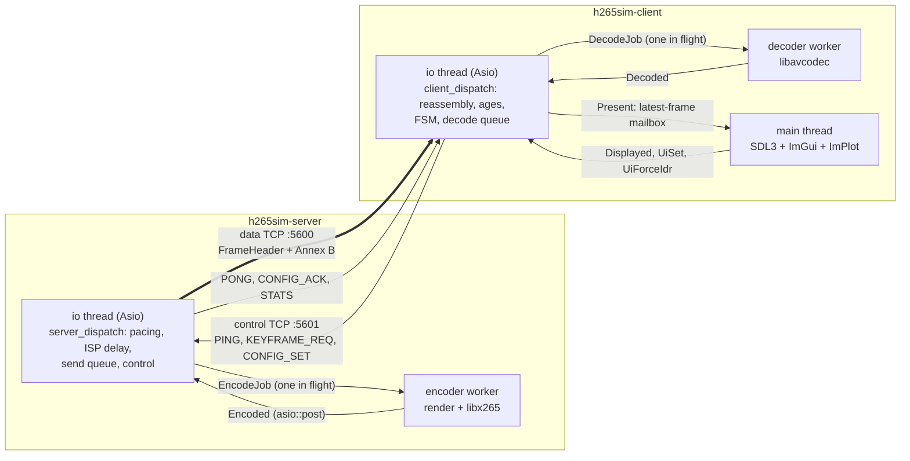
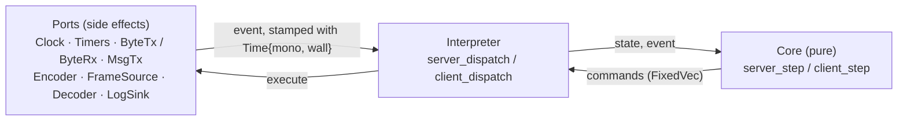
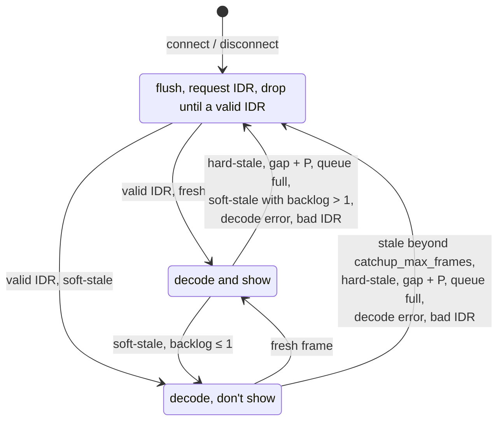

# H.265 camera simulator and low-latency client: implementation

Status: implemented and tested in simulation and on localhost. It has not yet been run under `tc netem` or across two hosts.
Companion to [h265-sim-architecture.md](h265-sim-architecture.md), the design document. This document describes what was built and how. Where the build differs from the design, §12 says why. Open work and open decisions are in §13.

---

## 1. Summary

- **Two binaries:**
  - `h265sim-server`: the camera simulator. It produces a synthetic picture, encodes it with libx265, and sends it over TCP with drop-to-IDR.
  - `h265sim-client`: the low-latency receiver. It tracks frame age, runs the staleness FSM, decodes with libavcodec and shows the result in an SDL3 window.
- **Deterministic simulator:** the same decision code as the binaries can run in virtual time, with a link model and a fake codec, either side alone or both together.
- **48 tests** in all, in both the debug (ASan/UBSan) and release builds:
  - unit tests;
  - an integration test against the real libx265 encoder and libavcodec decoder;
  - simulator scenarios taken from design doc §10.
- **Tools:**
  - `tools/netem/ns.sh` runs the two sides in network namespaces with `tc netem`;
  - `tools/analysis/breakdown.py` gives a per-stage latency breakdown from the two CSV logs.
- **Measured on localhost** (release build, 1080p30, 4 Mbit/s): the age on screen averages 9.5 ms, with p99 at 16 ms. Each cross-thread handoff costs 10–50 µs (§11).

Code size is about 4,600 lines of C++, plus the tests.

---

## 2. Architecture

### 2.1 Processes, threads and channels

**One logic thread per side.**
- Each side makes every decision on a single Asio io thread: pacing, the ISP delay, queueing, drops, the FSM and control handling.
- The heavy work runs on dedicated threads: encoding, decoding and rendering.
- Workers return results by posting completion events back to the io thread, so the logic never takes a lock.
- The only structures shared across threads are these, each guarded by a mutex:
  - the one-deep job slot of each worker;
  - the latest-frame mailbox;
  - the UI's row and status feed.

The design doc instead proposed a thread per stage with a lock-free mailbox. One logic thread was chosen so the simulator can replay exactly the same code deterministically. The cost is measured in §11.

**Two connections.** Data and control each have their own TCP connection, so PONG, ACK and STATS messages never queue behind video. The server serves one client at a time. A new connection replaces the old one and forces an IDR.

### 2.2 Pure cores, ports, interpreters

- **Cores** ([server/core.cpp](server/core.cpp), [client/core.cpp](client/core.cpp)): free functions over plain structs, of the form `step(State&, const Event&, Cmds&)`.
  - A core never reads a clock: every event carries `Time{mono_ns, wall_ns}`, stamped by the port that produced it.
  - Randomness (ISP jitter) comes from a seeded splitmix64 `Rng` held in the state.
  - Small decisions are pure functions that return values: ages, FSM transitions, drop decisions.
  - Big buffers are allocated once and changed in place.
- **Events and commands** are hand-written tagged unions: an enum `kind`, plus a union of trivially copyable structs. Every `switch` over them compiles with `-Werror=switch`, so a missing case fails the build.
  - Commands collect in a fixed-capacity `FixedVec` (16 on the server, 64 on the client).
  - Log rows are appended to preallocated rings in the state.
- **Interpreters** ([server/run.cpp](server/run.cpp), [client/run.cpp](client/run.cpp)) run the step, execute each command through the ports, drain the log rows to the `LogSink`, and publish the client status. The real binaries and the simulator share the same interpreters.
- **Enforced by the build.** The `h265core` library holds the cores, the interpreters, `common/` and `sim/`, and links no FFmpeg, Asio or SDL. Core code therefore cannot perform I/O.
- **Ports never re-enter dispatch from inside their own calls.** Completions are always delivered later, as new events. A `DataBytes` event's `Bytes` points into the port's read buffer and is valid only during that dispatch.

### 2.3 Ports

| Port | Role | Real implementation | Sim implementation |
|---|---|---|---|
| `Clock` | `now()`; `sync()` via `ntp_adjtime` | `RealClock` (`CLOCK_MONOTONIC` + `CLOCK_REALTIME`) | `SimClockPort` (virtual time, per-side offset and drift) |
| `Timers` | one timer per id; re-arming replaces it | `AsioTimers` (`steady_timer`) | `SimTimers` (generation-checked heap entries) |
| `ByteTx` | server data: `write`, then `WriteDone`, then `Writable` | `TcpDataServer`; `FileTx` for `--dump` | `SimDataTx` (link model) |
| `ByteRx` | client data: bytes in, `close()` | `TcpDataClient` | `SimDataRx` |
| `MsgTx` | control messages, both directions | `CtrlConn` | `SimCtrlTx` |
| `Encoder` | `submit(job, slot)` → `Encoded` | `AvEncoder` (libx265 on a worker) | `FakeEncoder` |
| `FrameSource` | fills the input picture | `SyntheticSource` | — (the fake encoder needs no pixels) |
| `Decoder` | `submit(job, au)` → `Decoded`; `present(seq)` → `Displayed` | `AvDecoder` (libavcodec on a worker) + `FrameMailbox` | `FakeDecoder` |
| `LogSink` | rows and status | `CsvLog`, `UiFeed`, `Tee` | `MemLog` (vectors read by tests) |

The interpreters fill one field themselves: every Timer event gets the `SyncStatus` from the `Clock` port. That way the cores see the clock-sync state without reading a clock.

### 2.4 Memory allocated up front

| What | Size |
|---|---|
| Server packet pool | (8 + 2) slots of `[FrameHeader][payload]`, each 48 B + `transport.max_frame_bytes` (2 MB). Metadata stored struct-of-arrays. |
| Server ISP ring | 2048 captures (32 B each) |
| Client frame pool | (8 + 2) slots of `max_frame_bytes`, plus a header, log row and show flag per slot |
| Decode queue | ring of 8 slot indices |
| Pending-display ring | 8 rows |
| Log rings | 256 rows per side, drained after each dispatch |
| libavcodec | `AVFrame` and `AVPacket` allocated once per encoder and decoder |
| Client socket read buffer | 64 KB |
| Control outbox | 64 KB, reserved |
| UI history | 1800 samples × 8 series, struct-of-arrays |

The pools are sized to their caps. Reaching the 8-slot cap would need `server.queue.max_frames = 8` (live-adjustable from 1 to 8) or `client.decode_queue = 8` (live-adjustable from 1 to 8).

---

## 3. Wire protocol

### 3.1 Data channel

The data channel carries one message per access unit: a `FrameHeader` followed by `payload_len` bytes of Annex B. VPS, SPS and PPS are repeated in-band before every IDR. The format is little-endian, which is asserted at compile time, and serialised with `memcpy`.

| Offset | Field | Notes |
|---|---|---|
| 0 | `magic` u32 | `"HSIM"` |
| 4 | `version` u16, `header_len` u16 | 1, 48 |
| 8 | `seq` u32 | **assigned when encoding starts**, so a gap means a lost reference |
| 12 | `gop_id` u32 | +1 on every key packet |
| 16 | `frame_type` u8, `flags` u8, `reserved` u16 | flags: bit0 forced IDR, bit1 IDR after a server drop |
| 20 | `reserved1` u32 | explicit padding: the doc's fields total 44 bytes packed |
| 24 | `capture_ts_ns` i64 | server `CLOCK_REALTIME` at capture |
| 32 | `send_ts_ns` i64 | patched by the interpreter just before the first write |
| 40 | `payload_len` u32, `reserved2` u32 | |

### 3.2 Control channel

Each control message is a `CtrlHdr{magic "HCTL", type u16, len u16}` followed by a fixed-size body. `ctrl_feed()` is an incremental pure parser. In memory, `CtrlMsg` is a tagged union of the bodies.

| Type | Direction | Body (bytes) | Fields |
|---|---|---|---|
| `PING` | C → S | 16 | nonce, `client_tx_ns` (client monotonic) |
| `PONG` | S → C | 32 | nonce, echo, `server_rx_ns`, `server_tx_ns` (stamped just before send) |
| `KEYFRAME_REQ` | C → S | 8 | reason (`KfReason`), `last_good_seq` |
| `CONFIG_SET` | C → S | 96 | key[48], value[48] |
| `CONFIG_ACK` | S → C | 104 | key, value, status (`Err`), `applied_at_seq` |
| `STATS` | S → C | 88 | queue frames/bytes, drops by reason, IDRs, keyframe requests, next seq, encode last/avg, server sync state and errors |

RTT is `(client rx − client tx) − (server tx − server rx)`, which subtracts the server's handling time.

---

## 4. Server

### 4.1 Events and commands

- **Events:** `Start`, `Timer` (Tick / Isp / Stats), `Encoded`, `WriteDone`, `Writable`, `DataConnected`, `DataDisconnected`, `Ctrl`.
- **Commands:** `ArmTimer`, `StartEncode`, `Write`, `SendCtrl`.

### 4.2 Pacing and the simulated ISP

- **Absolute deadlines.** Ticks fire at `epoch + k·10⁹/fps`, so the schedule never drifts.
  - If a tick wakes up more than a frame late, the schedule skips ahead rather than catching up in a burst.
  - A live fps change keeps the deadline already armed and switches to the new period after it.
- **Captures.** Each tick stamps a capture `{index, wall, mono}` and queues it in the ISP ring with `ready = max(t + delay ± jitter, previous ready)`, so the simulated ISP never reorders frames. With zero delay a capture goes straight to the encoder, with no timer round trip.
- **Rendering.** Pixels are rendered later, on the encoder worker, so only one raw frame buffer exists. The timestamp burned into the picture is still the capture time.

### 4.3 Encode scheduling

- At most one encode is in flight.
- If a capture becomes ready while the encoder is busy, it becomes the pending capture and replaces any older pending one. The replaced capture is logged as `encoder_busy` with `seq = -1`. It never needs an IDR, because it was never encoded.
- `StartEncode` carries:
  - `force_idr` (from a keyframe request or a server drop);
  - `reopen` (from a live encoder change);
  - the current `EncodeParams`.

### 4.4 Send queue and drop policy

The queue holds frames waiting to be sent, limited by `max_frames`, `max_bytes` and `max_age_ms`. All of these can be changed live.

1. **Enqueue**, when an encode completes:
   - **No client:** the frame is discarded silently.
   - **Waiting for an IDR:** a P-frame is dropped (`waiting_idr`). An IDR ends the wait and is marked *after drop*. If the dropped P-frame was one we had asked to be an IDR, the IDR is requested again.
   - **Overflow** (frames or bytes): every queued frame is dropped (`overflow`). Then:
     - a P-frame is dropped too, and the queue starts waiting for an IDR;
     - an IDR is kept, even if it alone exceeds `max_bytes`.
2. **Dequeue**, only when the socket reports writable:
   - If the head frame is older than `max_age_ms` (measured on the monotonic clock), it is dropped (`too_old`).
   - The P-frames behind it are dropped (`waiting_idr`) up to the next IDR in the queue.
   - If the queue empties, it waits for an IDR.
3. **Write.** The interpreter stamps `send_ts` and writes the whole frame. A frame that has started writing is always finished, since TCP can't cancel half a frame.

**Sender states:** `Disconnected` → `Writable` → `Writing` → `WaitWritable` → `Writable`. `WriteDone` and `Writable` events that don't match the current state come from a replaced connection and are ignored.

**What this guarantees:** the client never receives a P-frame whose reference was dropped. A gap in `seq` always lands on an IDR flagged *after drop*. A simulator test checks this.

### 4.5 Control handling and live configuration

- `PING` is answered with `PONG`. `KEYFRAME_REQ` sets the IDR request for the next encode.
- `CONFIG_SET` is applied to a copy of the config through `set_key(..., Live::Server)` and then `validate()`. The reply is a `CONFIG_ACK` with a status: `ok`, `unknown_key`, `not_live` or `bad_value`.
  - **Encoder keys** (`encoder.*`, and `source.fps`) set `reopen_pending`. Their ACK is held until the next `StartEncode`, so `applied_at_seq` names the frame where the change took effect. That frame is an IDR, because the encoder reopens.
  - **All other keys** apply immediately and are ACKed with `applied_at_seq = next_seq`.
- `STATS` is sent every `stats_interval_ms`. It includes the server's sync status, which comes from the interpreter as described in §2.3.

### 4.6 Encoder port

Details are in [server/encoder_av.cpp](server/encoder_av.cpp).

- **Settings.** libx265 through libavcodec, configured as in doc §4.3 with these differences:
  - `open-gop=0` is added. Without it, every keyframe after the first, forced or periodic, comes out as a CRA (NAL type 21) rather than an IDR, and a client can't join or recover at a CRA. The codec test caught this.
  - `log-level=error` is added.
  - `keyint` and `min-keyint` come from `encoder.gop`.
  - `rc_buffer_size = bitrate_kbps × vbv_ms` bits.
- **Startup.** The encoder is opened when the worker starts, so the first frame isn't slow.
- **Per frame:**
  1. `av_frame_make_writable`.
  2. `FrameSource::fill`.
  3. Stamp `enc_in`, so rendering counts as ISP time rather than encode time.
  4. `send_frame` / `receive_packet`, then copy the packet into the slot.
- **Checks.** Debug builds assert exactly one packet out per frame in, which proves the encoder isn't buffering.
- **Oversized packets.** A packet larger than the slot is reported as `encode_error`. The server drops it and waits for an IDR.

### 4.7 Synthetic source

Details are in [server/source.cpp](server/source.cpp).

- **Moving pattern:**
  - a diagonal luma ramp, drawn as one `memcpy` per row from a precomputed 256-periodic pattern;
  - a bar sweeping across the picture;
  - a chroma gradient.
- **Overlay:** a 7-segment, 8-digit frame index and the capture time as `HH:MM:SS.mmm` UTC. It is drawn on a neutral black box so it can be checked by eye. A unit test reads the digits back from the pixels.

### 4.8 TCP details

- **Server data socket:**
  - Socket options are `TCP_NODELAY`, `SO_SNDBUF = transport.sndbuf` (128 KB) and `TCP_NOTSENT_LOWAT = transport.tcp_notsent_lowat` (32 KB).
  - Each write is one `async_write`. After it completes, `async_wait(wait_write)` delivers `Writable`, so the drop decision is made in userspace with fresh information.
  - A read watch on the same socket detects the client closing it.
  - Handlers carry a connection generation number, so completions from a replaced connection are dropped.
- **Client data socket:** reconnects every second and reads in 64 KB blocks. The receive timestamp is taken when each read completes.
- **Control connection (`CtrlConn`):**
  - A pure parser reads messages.
  - Sends go through an outbox. If the peer stops reading, the outbox stops accepting messages beyond 64 KB, so the loop never blocks.
  - The client reconnects every second.

---

## 5. Client

### 5.1 Events and commands

- **Events:** `Start`, `Timer` (Ping / KfRetry), `DataConnected`, `DataDisconnected`, `DataBytes`, `Decoded`, `Displayed`, `Ctrl`, `UiSet`, `UiForceIdr`.
- **Commands:** `ArmTimer`, `StartDecode`, `Present`, `SendCtrl`, `CloseData`.

### 5.2 Reassembly

`reasm_feed()` is a pure function. It copies the header, validates it, takes a slot from the pool and copies the payload in.
- It records `recv_first` (when the first header byte arrived) and `recv_last` (when the read that completed the frame arrived). Ages use `recv_last`.
- A bad magic number, version or length is a protocol error: the client issues `CloseData`, the port reconnects, and bytes are ignored until it does.
- One read can complete many frames. A test covers 30 in one chunk.

### 5.3 Ages, trust and margin

`compute_ages()` follows doc §5.2:

| Quantity | Definition | Meaning |
|---|---|---|
| `camera_age` | `send − capture` | same clock, so no sync error |
| `transit` | `recv_last − send` | includes the sync error between the two clocks |
| `age_recv` | `recv_last − capture` | used for decisions |
| `D_min` | minimum transit over the last 10 s | 10 one-second buckets; anomalous frames are excluded |
| `queueing` | `transit − D_min` | independent of clock offset |

- **Anomaly.** A frame is flagged when transit is more negative than `max_negative_transit_ms`, `camera_age` is negative, or the age is over 60 s. It is logged and counted, but its age is not acted on.
- **Trust.** Ages are trusted when there is no anomaly and either `require_sync` is off, or the client is synchronised and the server has not reported otherwise in STATS.
  - Untrusted frames skip the `T_stale` and `T_hard` checks; only `queueing > Q_max` applies.
  - The UI flags untrusted ages.
- **Margin.** The age used for decisions is `age_recv + margin`. The margin is `clock.sync_margin_ms`; with `auto`, it is the client's `esterror` plus the server's.

### 5.4 Staleness FSM

- **Definitions:**
  - *hard-stale*: the frame's age is over `T_hard` (default 500 ms);
  - *soft-stale*: the age is over `T_stale` (400 ms), or `queueing` is over `Q_max`;
  - *backlog*: the decode-queue length;
  - *valid IDR*: the header says IDR, and `is_valid_idr()` finds NAL type 19 or 20 plus 32, 33 and 34.
- **Gaps.** A gap followed by an IDR is accepted without a flush: that is the server dropping to an IDR on purpose. A gap followed by a P-frame means a lost reference.
- **Every way into WAIT_IDR** returns `{Drop, flush, request_idr, reason}`. The flush:
  - empties the decode queue (those frames are logged as `flushed`);
  - discards the decode in flight;
  - makes the next `StartDecode` carry `flush_before`, so the decoder runs `avcodec_flush_buffers` first.
- **The FSM is a value.** `fsm_on_frame`, `fsm_on_decode_error` and `fsm_reset` are pure and tested transition by transition.

### 5.5 Decoding, presenting and frame fates

- One decode is in flight at a time.
- **Present-time check.** When `Decoded` arrives, the core checks freshness again before issuing `Present`: if the frame's trusted age plus margin now exceeds `T_stale`, it is not shown (`late`). This catches frames that went stale while queued or decoding.
- **Displayed.** The display reports `Displayed{seq}` once the frame is on screen. Presented frames that a newer one replaced first are logged as `superseded`.

Every frame ends with exactly one fate in the client CSV:

| Fate | Meaning |
|---|---|
| `shown` | on screen; `display_ts` and `age_show` are filled in |
| `dropped` | FSM verdict: not decoded |
| `hidden` | decoded during catch-up, not shown |
| `late` | decoded, but stale by present time |
| `flushed` | removed by a flush, from the queue or in flight |
| `superseded` | presented, but replaced before display |
| `decode_error` | the decoder rejected it, so the FSM goes to WAIT_IDR |

### 5.6 Keyframe requests

- A request goes out immediately if the last one was sent at least `keyframe_req_min_interval_ms` (300 ms) ago.
- Otherwise the retry timer is armed for the earliest allowed time, and the retry sends it.
- While the FSM stays in WAIT_IDR, retries double the interval each time, up to `keyframe_req_max_interval_ms` (2 s).
- Leaving WAIT_IDR resets the interval.
- The UI's *Force IDR* button bypasses the limiter.
- Sent requests are counted by reason: `connect`, `stale`, `gap`, `decode_error`, `queue_full`, `catchup`, `retry`, `manual`.

### 5.7 Decoder port and display

Details are in [client/decoder_av.cpp](client/decoder_av.cpp).

- **Decoder settings:** `AV_CODEC_FLAG_LOW_DELAY`, `FF_THREAD_SLICE` (never frame threading), and `client.decode_threads` threads.
- **Input.** Access units go straight from our framing to the decoder, with no parser or demuxer. The packet isn't refcounted, so libavcodec copies it into a padded buffer.
- **Errors.** A decode is reported as an error if it produced no picture or the picture is flagged corrupt.
- **Present.** `present(seq)` runs on the io thread while the worker is idle. What it does depends on the mode:
  - **UI mode:** it moves the decoded picture into the `FrameMailbox`, a single-slot "latest frame" handoff.
  - **Headless mode:** it reports `Displayed` immediately.

### 5.8 UI

Details are in [client/ui.cpp](client/ui.cpp).

- **Threading.** The UI runs on the main thread, as SDL requires. It reads the mailbox, takes rows and status from `UiFeed` (swapping the row vector under a mutex), and posts `UiSet`, `UiForceIdr` and `Displayed` events to the io thread.
- **Video.** An `SDL_PIXELFORMAT_IYUV` streaming texture, updated with `SDL_UpdateYUVTexture` (no colour conversion on the CPU) and letterboxed.
- **`display_ts`** is stamped right after `SDL_RenderPresent`.
- **Redraw rate.** The UI redraws immediately for a new frame, and at most every 8 ms otherwise.
- **`client.vsync`** switches `SDL_SetRenderVSync`.
- **Panels:**
  - **Status:** connection; FSM state; RTT; clock sync and trust; fate counts; keyframe requests by reason; server STATS; the last ACK.
  - **Server (live):** bitrate, GOP, fps, ISP delay and jitter, queue limits, preset, and *Force IDR*. These are sent as CONFIG_SET.
  - **Client (live):** `T_stale`, `T_hard`, `Q_max`, decode queue, catch-up frames, sync margin, `require_sync`. These apply locally.
- **Charts (ImPlot), over the last 20 s:**
  - age at receive and on screen, with the `T_stale` and `T_hard` lines;
  - queueing and minimum RTT;
  - frame size, with IDR markers;
  - FSM state.

---

## 6. Configuration

- **One file.** [config/h265sim.ini](config/h265sim.ini) is shared by both binaries; each uses the sections it needs.
- **Defaults:**
  - 1920×1080, 30 fps, GOP 60, 4 Mbit/s;
  - server queue: 3 frames, 200 ms;
  - `T_stale` 400 ms, `T_hard` 500 ms, `Q_max` 400 ms.
- **Three ways to change a key**, all through one key table in [common/config.cpp](common/config.cpp):
  - the INI file;
  - `section.key=value` command-line arguments, applied after the file;
  - live changes, through `set_key(cfg, key, value, Live::Server | Live::Client)`.
- **The key table.** Each entry records the key's type (int, bool, string, or margin, which also accepts `auto`), its range, its allowed values, and which side may change it live.
- **Validation.** `validate()` checks combinations across keys: even dimensions, `t_stale ≤ t_hard`, and the keyframe intervals in order. Live changes that fail validation are rejected, not applied.
- **Routing UI changes.** The client applies `client.*` and `clock.*` keys locally; every other key is sent as CONFIG_SET.

---

## 7. Logging and analysis

- **One CSV row per frame per side**, joined on `seq`. All timestamps are `CLOCK_REALTIME` nanoseconds.
  - Server rows (`server_frames.csv`): seq, gop_id, type, size, flags, capture, encoder in and out, enqueue, send start and end, dropped, drop reason. A capture dropped before encoding has `seq = -1`.
  - Client rows (`client_frames.csv`): the doc §7 columns plus `capture_ts`, `anomaly` and `fate`.
- **`breakdown.py`** ([tools/analysis/breakdown.py](tools/analysis/breakdown.py), run with `.venv/bin/python`) joins the two files and prints a per-stage table. The stages are ISP + render, encode, server queue, network, client queue, decode and display. It also prints the drop and fate counts, the number of frames shown older than `T_stale`, and the anomaly count. With `--plot` it writes the stages and ages over time to a PNG.

---

## 8. Simulator

The simulator lives in [sim/sim.hpp](sim/sim.hpp) and [sim/sim.cpp](sim/sim.cpp). It runs in a single thread.

**Pieces:**
- **Scheduler:** a heap ordered by (time, insertion order), so equal timestamps always run in the same order.
- **Clocks:** one `SimClockCfg` per side, with a wall offset, drift in ppm, and a reported sync status.
- **Links:** three, one for data and one for each direction of control. Each is a fluid TCP-like model:
  - bytes leave at `rate_bps`;
  - they arrive after `delay ± jitter`, never reordered;
  - they are delivered in chunks of at most 16 KB, which exercises reassembly;
  - the sender gets `WriteDone` and `Writable` once fewer than `lowat` bytes remain unsent.
- **Fake encoder:**
  - The average frame size is `bitrate / 8 / fps`. An IDR is 6× that and a P-frame 0.9×, each ±10%.
  - Its keyframe rule matches x265: the first frame, forced, reopen, or every GOP.
  - It emits real NAL headers padded with `0xAA`. Encoding takes 8 ± 1 ms.
- **Fake decoder:**
  - Decoding takes 4 ms.
  - It fails a P-frame that has no reference, for example one fed after a flush without an IDR.
  - It supports injected stalls and errors.
  - Display happens 2 ms after present.
- **Composition.** With both sides, the two cores talk over the links.
  - `with_client = false`: the server's frames go to a sink that records their headers.
  - `with_server = false`: `feed()` puts scripted frames on the data link.
- **Actions,** scheduled at chosen times:
  - `DataRate`, `DataStall` and `CtrlStall` change the links;
  - `DecoderStall` and `DecodeError` act on the fake decoder;
  - `ToServer` sends a control message to the server;
  - `ToClient` delivers a UI event to the client.

**Determinism.** The same config, parameters and seed always produce byte-identical rows. A test checks this, and also that a different seed produces different rows.

**Scenarios, from doc §10, over TCP.** These are the asserted results:

| Scenario | Setup | Result |
|---|---|---|
| Clean LAN | 100 Mbit/s, 0.5 ms | no drops; one KEYFRAME_REQ (on connect); every age on screen < 30 ms |
| Delay + jitter | 20 ± 5 ms | nothing hidden, late or dropped; ages rise by the added delay |
| Bandwidth collapse | 1 Mbit/s from 2 s to 7 s | **0 frames shown older than `T_stale`**; server drops to IDR; picture back within one GOP of the link returning (≈ 0.3 s in practice) |
| Client stall | decoder blocked 500 ms | 0 stale frames shown; picture back before 3 s (stall 2.0–2.5 s) |
| Control stall | control links blocked for 4 s, then a decode error | picture back at the next periodic IDR (≈ 0.5 s), while the keyframe request is stuck |
| Clock offset | client clock 5 ms behind | anomalies flagged, frames still shown |
| Server alone | collapse, keyframe request, CONFIG_SET | no P-frame after a gap; forced IDR within 2 frames; ACK names the IDR frame |
| Client alone | stale burst, decoder stall, gaps | fates exactly as specified, frame by frame |

---

## 9. Tests

All tests run from `ctest --preset debug` (ASan/UBSan) or `ctest --preset release`, using GoogleTest.

| Suite | Tests | Covers |
|---|---|---|
| `Wire` | 3 | header round trip; control stream fed one byte at a time, several messages per chunk, and garbage |
| `Config` | 4 | defaults; INI parsing (comments, sections, quotes, `auto`); the shipped INI; live keys and validation |
| `Nal` | 1 | 3- and 4-byte start codes; IDR validity |
| `Log` | 1 | CSV formatting; column counts match the headers |
| `Source` | 2 | 7-segment overlay read back from pixels; determinism and motion |
| `Codec` | 1 | **real** libx265 and libavcodec at 320×180: one packet per frame; every keyframe a real IDR; decoding across a flush |
| `ServerCore` | 10 | pacing; ISP delay; encoder busy; waiting for an IDR; overflow; too old; keyframe request; CONFIG_ACK timing; PING/STATS; stale completions |
| `Reasm`, `Ages`, `WinMin`, `Fsm` | 6 | client building blocks; the FSM transition table |
| `ClientCore` | 6 | keyframe rate limit and backoff; late frames; superseded frames; UI key routing; protocol errors; 30-frame bursts |
| `SimServer`, `SimClient`, `SimBoth` | 14 | the scenarios in §8 |

---

## 10. Build and layout

- **Toolchain:** C++17, CMake ≥ 3.28, Ninja. Presets in [CMakePresets.json](CMakePresets.json):
  - `debug`: ASan + UBSan;
  - `release`: RelWithDebInfo.
- **Dependencies:**
  - from the system: FFmpeg 8 (libavcodec with libx265, found via pkg-config), standalone Asio 1.30, SDL3 3.4, GTest 1.17;
  - via FetchContent, pinned: ImGui v1.92.9b and ImPlot v1.0.

| Target | Contents | Links |
|---|---|---|
| `h265core` | `common/` (except `real.cpp`), both cores and interpreters, the synthetic source, `sim/` | nothing external |
| `h265av` | `server/encoder_av.cpp`, `client/decoder_av.cpp` | FFmpeg, threads |
| `h265rt` | `common/real.cpp`: real clock, Asio timers, CSV, `CtrlConn`, config loading | Asio |
| `imgui` | ImGui + SDL3 backends + ImPlot | SDL3 |
| `h265sim-server` | `server/main.cpp`: TCP and file `ByteTx`, acceptors | h265av, h265rt |
| `h265sim-client` | `client/main.cpp`, `client/ui.cpp` | h265av, h265rt, imgui |
| `h265sim-tests` | `tests/*.cpp` | h265core, h265av, GTest |

How to run everything is in [README.md](README.md).

---

## 11. Measured performance

**Localhost, release build, 1920×1080 at 30 fps and 4 Mbit/s,** 10 s run, 299 frames, all shown, 0 older than `T_stale`. All values in ms.

| Stage | mean | p50 | p95 | p99 | max |
|---|---|---|---|---|---|
| ISP + render | 1.08 | 1.11 | 1.40 | 1.46 | 1.62 |
| encode | 6.67 | 6.56 | 7.31 | 12.47 | 13.64 |
| server queue | 0.02 | 0.01 | 0.03 | 0.03 | 0.04 |
| network | 0.05 | 0.04 | 0.08 | 0.09 | 0.12 |
| client queue | 0.02 | 0.01 | 0.03 | 0.05 | 0.10 |
| decode | 1.64 | 1.63 | 2.12 | 2.84 | 3.50 |
| display (headless) | 0.01 | 0.01 | 0.02 | 0.03 | 0.04 |
| **age on screen** | **9.47** | **9.29** | **10.75** | **16.32** | **18.48** |

- **Threading cost.** The `server queue`, `client queue` and `display` rows each include a cross-thread handoff: 10–20 µs in the release build, 30–50 µs under ASan. This is the measured cost of the one-logic-thread design.
- **Encode-time spikes** are the periodic IDRs.
- **Bandwidth collapse (simulated).** At 1 Mbit/s against a 4 Mbit/s stream, the client shows nothing for the whole 5 s collapse.
  - A 100 KB IDR takes 0.8 s to send, so it arrives older than `T_hard`.
  - Each overflow forces another IDR: 50 IDRs and 160 overflow drops in 12 s.
  - No stale frame is ever shown. The open question this raises is listed in §13.1.

---

## 12. Differences from the design document

| Design doc | As built | Why |
|---|---|---|
| A thread per stage, lock-free mailbox (§4.1, §5.1) | One logic thread per side plus worker threads | The simulator replays the same code deterministically; the handoff cost is measured at 10–50 µs |
| Control channel over UDP | Its own TCP connection | All traffic is TCP for now |
| TOML + CLI11 | INI file plus `section.key=value` arguments; hand-written parser | INI was requested; no extra dependency |
| `FrameHeader` "48 bytes, packed" | Explicit `reserved1` padding; 48 bytes, naturally aligned | The listed fields total 44 bytes packed |
| `seq` per captured frame | `seq` assigned when encoding starts | A gap then always means a lost reference |
| x265 parameters in §4.3 | Adds `open-gop=0` and `log-level=error`; `keyint` from config | Without `open-gop=0`, keyframes are CRA, not IDR |
| 25 fps, GOP 50, `T_stale` 150, `T_hard` 500, `Q_max` 50 | 30 fps, GOP 60, `T_stale` 400, `T_hard` 500, `Q_max` 400 | Requested values; `Q_max` scaled to match (see §13.1) |
| The display takes the latest decoded frame | Same, plus a freshness check at present time (`late`) | Keeps frames that went stale in the queue off the screen |
| Separate source and encode threads | Capture is a timer on the io thread; rendering happens on the encoder worker | Only one raw frame buffer is needed; render time is logged as ISP time |
| A Python notebook | `tools/analysis/breakdown.py` | A script is enough |
| C++20; SDL2 or SDL3 | C++17; SDL3 | Requested |

---

## 13. Still to do or decide

### 13.1 Decisions needed

1. **What the server should do when the link is slower than the bitrate.**
   - **The problem.** At present every overflow forces an IDR. An IDR costs several P-frames' worth of bytes: 4–6× with real x265 on synthetic content, and 6× in the fake encoder. On a link below the bitrate this feeds itself: the simulated collapse produced 50 IDRs in 12 s and nothing usable on screen (§11).
   - **Options:**
     - rate-limit IDRs the server forces itself;
     - make dropping to an IDR wait for the next periodic IDR when one is near;
     - lower the bitrate automatically (needs a policy);
     - accept it, and lower the bitrate by hand from the UI.
   - **Depends on** how the real CV25 behaves.
2. **What `Q_max` should mean.** At 400 ms it duplicates `T_stale` whenever ages are trusted.
   - **Option A:** apply it only when ages are untrusted, as the fallback.
   - **Option B:** make it much smaller (tens of ms) as an early warning that moves the client into CATCHUP. The doc's original 50 ms sat alongside a 150 ms `T_stale`.
3. **TCP or UDP on the rail network.** Everything is TCP for now. UDP (design doc §4.5, phase 2) only makes sense if it is measured on the real network and works better.
4. **Thresholds per consumer** (doc question 3). There is one client today, with global thresholds.
5. **The `require_sync` default.** It is `true`. On a host that isn't NTP-synchronised, ages become untrusted and the client falls back to queueing only. Same-host runs could safely use `false`. The question is what default the demo machines should get.
6. **More than one client.** Today a new connection replaces the old one. Serving several needs a send queue per client and per-client IDR handling.
7. **Questions that depend on the hardware** (doc §12). They remain open, and each changes the design:
   - Does the CV25 accept on-demand IDR requests through the vendor SDK? If not, recovery depends on the periodic IDR, so the GOP length is the worst-case recovery time and the server should model that.
   - Does the camera run an NTP client, and how does the vendor SDK's PTS map to `CLOCK_REALTIME`? This decides how `capture_ts` is produced on the real camera.
   - Is PTP available? It would shrink the sync margin from milliseconds to microseconds, with no change to this design.
   - Does the encoder support hierarchical P or temporal layers? If so, a "drop non-reference frames" level could sit between NORMAL and WAIT_IDR. It has been left out until this is known.
8. **Security.** Both ports listen on all interfaces with no authentication, and CONFIG_SET can change encoder settings. That is fine on an isolated test network; decide before the simulator goes anywhere else.
9. **Licensing.** An FFmpeg build with libx265 is GPL (doc §8). Fine for an internal tool; check before anything ships.

### 13.2 Verification still to run

- **netem scenarios.** [tools/netem/ns.sh](tools/netem/ns.sh) needs sudo and has only been checked for syntax. Run every profile and confirm the doc §10 expectations against real TCP behaviour, including netem's own queueing. The `ctrlstall` profile needs `iptables` inside the namespace.
- **The UI on a real display.** So far it has only been checked with SDL's offscreen driver and a screenshot. Measure the latency with vsync on and off.
- **Two hosts with NTP** (doc §10, "NTP under load"). Check the reported sync error, the effect of the `auto` margin, and how ages compare with same-host runs.
- **Real footage.** Synthetic content compresses unrealistically well: IDRs are about 50 KB at 4 Mbit/s. Results under constrained bandwidth should be repeated with real camera footage (see §13.4).
- **Version control.** The code is not committed yet: everything is untracked in git. There is no CI either.

### 13.3 Known limitations in the current code

- **Simulator link model.** Departure times are fixed when bytes are written, so a rate change only affects later writes. A big IDR started at the slow rate finishes at that rate, which makes recovery look about 0.3 s slower than it would be. The fix is to schedule chunk departures one at a time. This is marked in [sim/sim.cpp](sim/sim.cpp).
- **`D_min` granularity.** The window uses 10 one-second buckets. Switch to a monotonic deque if finer windows matter.
- **Clock cross-checks from doc §5.2 are not implemented.**
  - Persistent divergence between `transit` and `D_min + queueing` is not detected.
  - "One-way transit must not exceed the RTT" is not checked.
  - Only the per-frame anomaly flag exists.
- **Live encoder changes reopen the encoder.** That forces an IDR and costs one slow frame. `x265_encoder_reconfig` through the x265 API directly would avoid both.
- **An IDR larger than the frame limit loops forever.** Such an IDR is dropped as `encode_error`, the next forced IDR is just as large, and so on. 2 MB is ample at 1080p and 4 Mbit/s, but high bitrates or 4K need a larger `transport.max_frame_bytes`, or the encoder's VBV has to bound the IDR size.
- **Receive timestamps** are taken when bytes reach userspace. `SO_TIMESTAMPING` would give kernel arrival times, if that difference ever matters.
- **x265's thread pool uses every core.** If the CSV shows the io thread waking up late under load, restrict it with the x265 `pools=` parameter.
- **Debug runs of the client.** Under ASan, the client reports a small leak inside SDL and Mesa (libdrm) at exit. Add an LSan suppression file for debug runs.
- **UI details:**
  - the preset list offers 6 of the 10 x265 presets;
  - the threshold lines on the age chart follow the edited value before it is applied.
- **Unsupported values.** `source.kind` and `encoder.backend` accept only `synthetic` and `libx265` until the extensions in §13.4 exist.

### 13.4 Extensions (design doc M7), each with its port ready

| Extension | Where it plugs in |
|---|---|
| File playback with real rail footage: libavformat decode, libswscale, looping | a new `FrameSource`; `source.kind = file` |
| V4L2 webcam source | a new `FrameSource` |
| UDP data transport: ≤ 1200-byte fragments, paced IDR fragments, loss → WAIT_IDR | a new `ByteTx`/`ByteRx` pair, plus a fragment header (doc §3.1) |
| `hevc_nvenc` backend | `Encoder`, with its own `forced-idr`, `zerolatency`, `delay=0` and `rc=cbr` options |
| Hardware decode (VAAPI / CUDA) | `Decoder`; measure whether it actually lowers latency |
| SEI timestamps (`udu_sei`), to compare with the header | encoder and decoder ports; the header stays the source of truth |
| Dropping non-reference frames | the FSM, only if the CV25 supports temporal layers |
